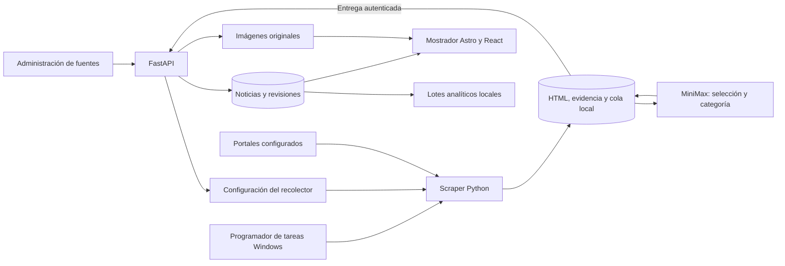

# UniNews: scraper Python y mostrador de noticias universitarias — Implementation Plan

> **For agentic workers:** REQUIRED SUB-SKILL: Use `executing-plans` to implement this plan task-by-task. Steps use checkbox (`- [ ]`) syntax for tracking. La modalidad inicial es secuencial; delegar solo cuando esté autorizado y siguiendo AGENTS.md.

**Goal:** Completar y verificar UniNews para recopilar noticias originales de universidades de Chile mediante Python y mostrarlas en una web con búsqueda, filtros, imágenes y revisión administrativa.

**Architecture:** Conservar el recolector Windows independiente, su cola SQLite y la extracción con MiniMax por OpenRouter. FastAPI recibe resultados idempotentes, conserva evidencia y publica en la base operacional; Astro con React consume exclusivamente noticias publicadas. Validar primero todo localmente; BigQuery y el despliegue cloud mantienen sus fases posteriores.

**Tech Stack:** Python propio, HTTPX, BeautifulSoup, feedparser, Pydantic, Playwright Python opcional; FastAPI, SQLAlchemy, Alembic y SQLite; Astro 6, React 19 y Tailwind existentes; pytest y pruebas de navegador. Node `>=22.12.0` según `package.json`; Python 3.12 es el objetivo de la especificación, mientras que el informe histórico solo acredita 3.14.7.

**Spec:** [Especificación funcional y técnica vigente](../specs/2026-09-06-uninews-python-openrouter.md). Leer también [roles y contratos](../specs/2026-09-06-agent-roles.md), [AGENTS.md](../../../AGENTS.md) y el [plan anterior](2026-09-06-uninews-python-openrouter.md).

Fecha: 2026-10-03, America/Santiago. Estado: **planificación; implementación y aceptación de estas tareas pendientes**.

## Global Constraints

- U01: El scraper se implementará en Python y no utilizará ScrapeGraphAI ni servicios de scraping por créditos.
- U02: El único modelo del flujo de extracción será `minimax/minimax-m3:free` mediante OpenRouter; no habrá sustitución automática por modelos de pago ni ejecución de un LLM local.
- U03: El recolector se ejecutará en Windows, en una máquina diferente del servidor de la web, API y base de datos central.
- U04: Las universidades y sus enlaces serán configurados por el administrador; el recolector no incorporará universidades descubiertas por su cuenta.
- U05: Cada noticia publicable tendrá título, cuerpo original, categoría, fecha de publicación, nombre de universidad y URL de origen.
- U06: La fecha de extracción nunca se presentará como fecha de publicación; una fecha ausente o inválida impedirá la publicación automática.
- U07: Los artículos descargados y sus pendientes sobrevivirán a reinicios, falta de cuota de OpenRouter y desconexiones de la API central.
- U08: La comunicación entre recolector y servidor se realizará mediante una API autenticada por HTTPS; no se compartirá un archivo SQLite entre máquinas.
- U09: Astro consultará las noticias publicadas mediante FastAPI; ninguna clave de OpenRouter o del recolector se incluirá en el frontend.
- U10: Una entrega repetida del mismo artículo no creará noticias duplicadas ni sobrescribirá una edición humana con una revisión antigua.
- U11: El plan y su implementación conservarán los datos existentes; las migraciones y la restauración se verificarán sobre copias.
- U12: Las pruebas automatizadas habituales no realizarán llamadas a OpenRouter ni a universidades reales.
- U13: Se extraerá la imagen principal cuando exista, conservando su origen y metadatos; una imagen ausente o fallida no se reemplazará por una imagen generada.
- U14: El desarrollo y las pruebas de aplicación se completarán primero localmente, sin exigir recursos Google Cloud; la carga real de datos a BigQuery será una etapa posterior.
- U15: BigQuery almacenará datos analíticos versionados y consultables, con carga repetible y seguimiento de publicaciones, cambios y archivos; no sustituirá la base operacional de la web.
- U16: Los agentes tendrán roles, propiedad de archivos, contratos de entrega y reglas de coordinación explícitos en AGENTS.md y en la especificación de agentes.

## 1. Alcance y resultado esperado

Dos bloques con aceptación separada, unidos por los contratos existentes:

1. **Scraper Python:** administrar universidades y fuentes, probar una muestra, descargar HTML/RSS o renderizar JavaScript cuando el perfil lo requiera, conservar evidencia, extraer texto/fecha/categoría e imagen, recuperar errores y ejecutar automáticamente en Windows.
2. **Mostrador de noticias:** publicar únicamente noticias válidas; mostrar título, institución, fecha original, categoría, cuerpo, imagen disponible y enlace institucional; buscar, filtrar por universidad/categoría/fechas, paginar y actualizar sin perder la lectura abierta. Administración para revisar, corregir, publicar y archivar.

El panel administrativo es necesario para controlar las fuentes y la calidad. No se agrega un rediseño completo, otro framework, un chat nuevo ni una dependencia cloud para usar la web. Se conservan los componentes y estilos actuales.

Para el piloto se necesita la lista de universidades y URLs que el usuario quiera seguir. UPLA es una referencia del proyecto, no una fuente acreditada ni una autorización para añadir otras instituciones. Esa lista es una entrada para ejecutar el piloto, no un impedimento para completar este plan. No se garantiza cobertura de todas las universidades de Chile.



## 2. Punto de partida comprobado por lectura

`git status --short` no mostró cambios preexistentes al iniciar esta planificación ni al retomarla. No se ejecutaron las pruebas de producto en esta sesión. Los resultados de septiembre son históricos y no acreditan el estado actual.

| Área | Ya existe | Qué debe completarse o verificarse |
|---|---|---|
| Recolector | `collector/` contiene HTTP, descubrimiento, documentos, LLM, cola, imágenes, sync y CLI | Estados bloqueados, cuota global, fallos visibles, reparto entre fuentes y recuperación de imágenes |
| API y datos | Fuentes, revisiones, recibos, autenticación y cuatro migraciones | Revalidación central de evidencia, identidad completa de revisión y coherencia de publicación |
| Web | `NewsPage.tsx` muestra tarjetas, búsqueda, categoría, diálogo, paginación y refresco | Filtro visible de universidad, rango de fechas y pruebas funcionales de UI |
| Contrato de consulta | `NewsParams` declara fechas; la API recibe universidad | `list_news` aún no procesa fechas; estadísticas solo devuelven nombres de universidades |
| Recuperación | CLI `retry` y `backup`, con pruebas dedicadas | Verificar comportamiento actual; no reimplementarlos por un informe antiguo |
| Windows | Scripts de instalación y tarea programada | Dry-run real del registro y evidencia de 72 horas sin sesión |
| QA | Tests y herramientas de evaluación | `test_public_visibility.py` contiene solo `assert True`; faltan pruebas efectivas y corpus real |
| Analítica | Outbox y exportador local | `record_version` usa un hash de timestamp, que no asegura orden; hay escrituras que no emiten evento |

Observaciones de código que motivan tareas concretas:

- `CollectorStore.block()` deja `next_attempt_at=NULL`; `pending()` admite valores nulos y puede recuperar elementos bloqueados permanentemente.
- `pending()` aplica `LIMIT` antes de que el pipeline filtre por fuente; una fuente puede ocupar todos los puestos del lote.
- `run_once()` silencia errores de descubrimiento; `MiniMaxExtractor.check_model()` existe, pero no se invoca en ese flujo.
- Un error al descargar la imagen se descarta en `_fetch_due()`; sin registro local, `image_for_item()` devuelve `not_found`.
- La ingesta confía en `delivery.issues`; la deduplicación de revisiones omite `canonical_url` y la publicación necesita contrastar evidencia en el servidor.
- `NewsResponse.published_on` está tipado como `datetime`, aunque la columna es `Date` y la interfaz utiliza un día editorial.

Son hallazgos de inspección para reproducir con tests antes de modificar comportamiento, no resultados de pruebas ejecutadas.

## 3. Mapa de propiedad, archivos y contratos

| Responsable secuencial | Archivos existentes a modificar | Archivos nuevos previstos |
|---|---|---|
| Coordinación/QA | `tests/conftest.py`, `requirements-dev.in`, `requirements-dev.txt`, `package.json`, `package-lock.json`, documentos de aceptación | `tests/integration/conftest.py`, `docs/acceptance/2026-10-03-baseline.md` |
| Backend | `backend/config.py`, `backend/services/ingestion.py`, `backend/services/analytics_events.py`, `backend/models.py`, `backend/schemas.py`, `backend/routers/news.py`, `backend/routers/admin.py` | `backend/migrations/versions/0005_news_integrity.py`, tests de integridad/publicación/filtros |
| Recolector | `collector/store.py`, `collector/pipeline.py`, `collector/discovery.py`, `collector/openrouter.py`, `collector/__main__.py`, `collector/images.py`, `collector/sync.py` | `collector/retry_policy.py`, `tests/integration/test_collector_recovery.py`, `tests/integration/test_collector_circuit.py`, `tests/integration/test_source_preview.py` |
| Frontend | `src/components/NewsPage.tsx`, `src/lib/api.ts`, componentes en `src/components/admin/` | `src/components/news/NewsFilters.tsx`, `src/components/news/NewsDialog.tsx`, `playwright.config.ts`, `tests/e2e/news.spec.ts`, `tests/e2e/admin.spec.ts` |
| Operación/tesis | `scripts/windows/register-collector-task.ps1`, `scripts/windows/run-collector.ps1`, `evaluation/README.md`, `evaluation/compare.py`, `evaluation/schema.json`, `tests/unit/test_evaluation_metrics.py`, `README.md` | `scripts/windows/test-collector-task.ps1`, `docs/operations/windows-collector.md`, `docs/acceptance/2026-10-03-local.md` |

Las rutas son relativas a la raíz del repositorio. Leer cada archivo antes de editarlo; no realizar formateo masivo. Si ya existe la revisión Alembic propuesta al ejecutar, elegir el siguiente ID libre y ajustar referencias antes de crearla.

Contratos que se conservan: `SourceConfig`, `Document`, `Selection`, `ArticleFields`, `Delivery`, `Receipt`, `ImageAsset`, `ImageDelivery`, `RunReport` y `RunSummary` de `shared/contracts.py`; `run_once(settings, *, clock, monotonic, http_transport) -> RunSummary`; `ingest(db, delivery, now) -> Receipt`.

Propuestas aditivas de este plan, que deben registrarse en la especificación al implementarlas:

- `CollectorStore.pending(stage, now, limit, *, source_id=None)` limita después de filtrar por fuente y excluye bloqueos permanentes/fallos agotados.
- `CollectorStore.llm_pause(now) -> dict | None`, `pause_llm(code, until) -> None` y `clear_llm_pause() -> None`: estado persistente global; `until=None` indica intervención necesaria.
- `GET /api/news/universities` devuelve `[{"id": 1, "name": "Universidad configurada"}]`, solo instituciones con noticias publicadas. Registrar antes de `/{news_id}`.
- `GET /api/news/?university_id=1&category=Cultura&date_from=2026-09-01&date_to=2026-09-30&skip=0&limit=21`: rango inclusivo por `published_on`, fechas ISO y 422 si el inicio supera al fin.
- `NewsResponse.published_on: date | None` se serializa como `YYYY-MM-DD`; añadir `image_alt` e `image_credit` opcionales sin romper consumidores existentes.
- `News.record_version: int` creciente por noticia, dentro de la transacción; sustituye el hash como orden de eventos nuevos.

No se cambia silenciosamente `shared/`, un lock ni una migración. El ejecutor que esté a cargo de esas rutas registra el cambio y ejecuta sus pruebas de consumidores. No hace falta despachar agentes para aplicar los roles secuencialmente.

## 4. Secuencia de ejecución

T1 → T2 → T3 → T4 → T5 → T6 → T7 → T8 → T9 → T10.

T2 es la base de integridad común. T3–T6 cierran el scraper; T7–T8 cierran el mostrador y administración. T9–T10 comprueban operación y aceptación. Cada tarea se entrega con sus archivos, comandos/resultados, cambios de configuración y riesgos pendientes. Los commits indicados son para la futura ejecución, con rutas explícitas y sin push automático.

### T1. Establecer una línea base y fixtures de integración confiables

**Files:** crear `tests/integration/conftest.py` y `docs/acceptance/2026-10-03-baseline.md`; revisar `tests/conftest.py`, `pytest.ini`, `requirements-dev.in`, `requirements-dev.txt` y `package.json`.

**Interfaces:** consumir `bootstrap_database(url)`, `create_app(BackendSettings(...))` y `app.state.session_factory`; producir fixture `api_client` con API y SQLite temporal aisladas.

- [ ] Ejecutar `git status --short` y registrar cambios ajenos antes de editar.
- [ ] Registrar versiones con `.\.venv\Scripts\python.exe --version`, `node --version` y `npm.cmd --version`. Si falta el entorno, prepararlo según README; no usar bases reales para tests.
- [ ] Ejecutar la base actual, sin red externa:

```powershell
.\.venv\Scripts\python.exe -m pytest tests/unit tests/integration -q
npm.cmd run typecheck
npm.cmd run lint
npm.cmd run build
```

- [ ] Guardar comando, fecha, versión, código de salida y fallos en el informe; no copiar el resultado histórico de 37 tests como resultado actual.
- [ ] Crear la fixture para las nuevas pruebas API. Tokens siguientes solo pertenecen al entorno temporal de tests; revisar los nombres de configuración existentes antes de fijarlos:

```python
import pytest
from fastapi.testclient import TestClient
from backend.config import BackendSettings
from backend.main import create_app
from backend.scripts.bootstrap_db import bootstrap_database
from pydantic import SecretStr

@pytest.fixture
def api_client(tmp_path, monkeypatch):
    monkeypatch.setenv("ADMIN_TOKEN", "admin-test")
    monkeypatch.setenv("COLLECTOR_TOKEN", "worker-test")
    url = "sqlite:///" + (tmp_path / "api.db").as_posix()
    bootstrap_database(url)
    app = create_app(BackendSettings(
        _env_file=None, database_url=url, media_root=tmp_path / "media",
        admin_token=SecretStr("admin-test"),
        collector_token=SecretStr("worker-test"), rag_enabled=False,
    ))
    with TestClient(app) as client:
        yield client
    app.state.engine.dispose()
```

`create_app` expone actualmente `app.state.engine`; disponer ese engine en el teardown mantiene los archivos temporales liberados. Nunca cambiar producción para adaptar una fixture.

- [ ] Validar la fixture con `GET /api/news/`, esperando 200 y lista vacía, y volver a ejecutar integración.
- [ ] Commit sugerido: `test: establish isolated local acceptance baseline`, añadiendo únicamente fixture e informe.

**Aceptación:** existe evidencia actual y reproducible; cada fallo previo queda diferenciado de los cambios posteriores.

### T2. Garantizar integridad antes de publicar y preservar datos

**Files:** modificar `backend/config.py`, `backend/services/ingestion.py`, `backend/services/analytics_events.py`, `backend/models.py`, `backend/schemas.py`, `backend/routers/news.py`, `backend/routers/admin.py`; crear `backend/migrations/versions/0005_news_integrity.py` y `tests/integration/test_publication_integrity.py`; ampliar `test_ingestion.py`, `test_migrations.py`, `test_analytics_export.py`; sustituir el cuerpo de `test_public_visibility.py`.

**Interfaces:** conservar `ingest(db, delivery, now) -> Receipt`; consumir `materialize(doc: Document, selection: Selection, timezone_name: str) -> ArticleFields` y `validate_article(fields: ArticleFields, doc: Document, selection: Selection | None, source: SourceConfig, now: datetime) -> list[str]` de `shared/validation.py`, así como el snapshot `SourceVersion`. Producir recibos atómicos y eventos ordenados por `record_version`.

- [ ] Registrar la propuesta de migración: incluir `canonical_url` en la identidad única de revisión y añadir `news.record_version` con valor inicial 0 para nuevas bases. Ensayar el cambio en copia SQLite; no eliminar revisiones para satisfacer una restricción.
- [ ] Añadir una regresión al test de ingesta existente: enviar selección y campos inconsistentes con `issues=[]`; debe guardarse revisión pendiente y no aparecer una noticia pública. Usar título ≥5 caracteres y cuerpo ≥200 para el caso positivo; los valores actuales `T` y `Body` no prueban el umbral requerido.
- [ ] Añadir prueba de visibilidad real, sustituyendo `assert True`:

```python
from models import News

def test_draft_is_hidden_from_detail_list_and_stats(api_client):
    with api_client.app.state.session_factory() as db:
        row = News(title="Borrador reservado", content="Texto interno",
                   category="General", university="Universidad de prueba",
                   publication_status="draft")
        db.add(row)
        db.commit()
        db.refresh(row)
        news_id = row.id
    assert api_client.get(f"/api/news/{news_id}").status_code == 404
    assert api_client.get("/api/news/").json() == []
    assert api_client.get("/api/news/stats").json()["total_news"] == 0
    assert api_client.delete(f"/api/news/{news_id}").status_code in (401, 403)
```

- [ ] Ejecutar los casos nuevos por nombre y guardar el fallo que demuestra el defecto. Si ya pasan, conservarlos como regresión y no modificar ese comportamiento.
- [ ] Reconstruir campos desde bloques en el servidor, validar hash, selección, fecha, URL y política de fuente; combinar errores calculados con los recibidos. El nombre de universidad siempre viene de su registro. Una revisión antigua de configuración se conserva, pero no habilita automáticamente la política nueva.
- [ ] Deduplicar por `(source_id, canonical_url, document_hash, prompt_version, source_revision)`; repetir `delivery_id` y payload devuelve el mismo recibo, mientras que reutilizarlo con payload distinto devuelve 409.
- [ ] Aplicar también validación editorial al publicar manualmente: campos requeridos, fecha verificable y universidad configurada. Retirar el valor predeterminado ficticio del esquema de creación; no modificar nombres históricos en lote.
- [ ] Eliminar credenciales de prueba predeterminadas de la configuración operativa: exigir tokens no vacíos y distintos para admin y collector. Los tests pasan tokens explícitos mediante la fixture. Añadir casos que rechacen token ausente/igual y que un token collector no autorice escrituras admin; mantener errores sin imprimir secretos.
- [ ] Sustituir el hash de timestamp por incremento transaccional y emitir evento en publicación, edición, archivo y cambio de imagen. SQLite utiliza transacciones breves y actualización atómica; fallo en crear el evento revierte esa mutación.

```python
# Dentro de la misma transacción que modifica la noticia.
from sqlalchemy import update
version = db.execute(
    update(News).where(News.id == news.id)
    .values(record_version=News.record_version + 1)
    .returning(News.record_version)
).scalar_one()
# emit_event usa version como record_version; no invoca commit.
```

Para una base con eventos previos, inicializar el contador por noticia por encima del máximo almacenado; no reescribir eventos históricos ni afirmar que el orden anterior queda reparado. Registrar la limitación y preparar un snapshot nuevo para la exportación futura.

- [ ] Probar 100 reenvíos, dos URLs con mismo cuerpo, revisión tardía, bloqueo editorial, rollback del evento, rutas públicas y media/chat; comparar IDs y filas antes/después de migrar una copia.
- [ ] Ejecutar `pytest` sobre ingesta, integridad, visibilidad, migraciones, RAG y exportación. Commit sugerido: `fix: validate publication and preserve revision integrity` con rutas de esta tarea.

**Aceptación:** no se publica contenido inválido por confiar en el recolector; no se duplican entregas ni se pierden ediciones o revisiones. AC05, AC06, AC08 y AC09 tienen tests efectivos.

### T3. Hacer recuperable y equitativa la cola del scraper

**Files:** modificar `collector/store.py`, `collector/pipeline.py`, `collector/discovery.py`; crear `collector/retry_policy.py`, `tests/integration/test_collector_recovery.py`; ampliar `test_collector_store.py`, `test_discovery.py`, `test_cli_recovery.py`.

**Interfaces:** `pending(stage, now, limit, *, source_id=None)`; conservar `block`, `defer`, `retry_item`, `source_cursor` y `save_discovery`. `retry_at(attempt: int, now: datetime, retry_after: datetime | None, jitter_seconds: float) -> datetime` será función pura en `retry_policy.py`.

- [ ] Añadir y ejecutar esta regresión contra el código actual:

```python
from datetime import UTC, datetime
from uuid import uuid4
from collector.store import CollectorStore
from shared.contracts import SourceConfig

def test_permanent_block_never_returns_as_pending(tmp_path):
    now = datetime(2026, 10, 3, tzinfo=UTC)
    source = SourceConfig(id=1, university_id=1, university_name="Prueba",
        revision=1, start_url="https://uni.test/noticias",
        allowed_hosts=["uni.test"])
    with CollectorStore(tmp_path / "queue.db") as store:
        item = store.enqueue_url(source, "https://uni.test/a", uuid4())
        store.block(item, "download", "robots_denied")
        assert store.pending("download", now, 10) == []
```

- [ ] Separar estado reintentable de bloqueo permanente. `defer` mantiene el estado de etapa con próximo intento; `block` nunca entra en consultas automáticas. Migrar registros antiguos reintentables identificados por `next_attempt_at` sin borrar pendientes.
- [ ] Añadir `source_id` al SQL antes del `ORDER BY` y `LIMIT`; ordenar por próximo intento e ID. Verificar dos fuentes con más pendientes que el límite y que ambas avanzan.
- [ ] Implementar esperas 60, 300, 1800, 7200 y 21600 segundos con jitter inyectable; prevalece un `Retry-After` válido. Al agotarse, estado `failed` visible y recuperación explícita con el CLI existente. No reintentar automáticamente 401/403, CAPTCHA ni robots denegado.
- [ ] Corregir el cursor cuando `max_articles` se alcanza a mitad de página: persistir esa página y continuar descartando URLs ya conocidas; no saltar directamente a la página siguiente y perder enlaces.
- [ ] Mantener documento antes del LLM y payload antes de red. Ensayar cierre/reapertura en cada frontera con SQLite temporal y API que pierde la respuesta después de aceptar.
- [ ] Guardar `no_links`, `partial`, errores y contadores por fuente, en vez de compartir totales acumulados entre reportes. Distinguir listado con solo enlaces ya conocidos de selector que no encontró enlaces.
- [ ] Ejecutar pruebas de cola, descubrimiento, recuperación CLI y protocolo de runs. Commit sugerido: `fix: recover collector work without starvation or silent loss`.

**Aceptación:** reiniciar conserva trabajo, repetir no vuelve a consumir LLM para documentos idénticos y los bloqueos no generan bucles. AC03 y parte de AC02.

### T4. Controlar cuota y disponibilidad del LLM de forma global

**Files:** modificar `collector/store.py`, `collector/openrouter.py`, `collector/pipeline.py`, `collector/__main__.py`; crear `tests/integration/test_collector_circuit.py`; ampliar `test_openrouter_extraction.py`.

**Interfaces:** métodos `llm_pause`, `pause_llm` y `clear_llm_pause` definidos en §3, respaldados por la tabla existente `runtime_state`; conservar `MiniMaxExtractor.extract(doc) -> Selection`. Añadir `python -m collector --env RUTA resume-llm` para revalidar modelo/credenciales y levantar pausa cuando resulte válido.

- [ ] Escribir y ejecutar la prueba de persistencia del circuito:

```python
from datetime import UTC, datetime, timedelta
from collector.store import CollectorStore

def test_llm_pause_survives_restart(tmp_path):
    now = datetime(2026, 10, 3, tzinfo=UTC)
    path = tmp_path / "queue.db"
    with CollectorStore(path) as store:
        store.pause_llm("quota", now + timedelta(seconds=120))
    with CollectorStore(path) as store:
        assert store.llm_pause(now)["code"] == "quota"
        assert store.llm_pause(now + timedelta(seconds=121)) is None
```

- [ ] Comprobar modelo exacto y precio cero antes de la primera extracción de la invocación. Precio ausente no demuestra gratuidad; suspender extracciones si la comprobación falla y conservar documentos.
- [ ] Consultar la pausa global antes de reservar presupuesto. Con 429, persistir plazo y detener nuevas llamadas para todas las fuentes, continuando descargas y entregas.
- [ ] Ante 401/402/403/modelo ausente, conservar documentos pendientes y una causa global hasta `resume-llm`; no convertir cada fallo de credenciales en un supuesto artículo extraído.
- [ ] Diferenciar salida inválida de indisponibilidad: máximo dos intentos totales de JSON/selección por documento y luego revisión con evidencia; cada intento cuenta en presupuesto persistente. Admitir `Retry-After` numérico o fecha HTTP.
- [ ] Aplicar límite de tiempo restante antes de cada operación; el timeout HTTP/LLM no supera ese tiempo. Pausar descargas con menos de 1 GiB libre o cola superior a 2 GiB; mantener sincronización.
- [ ] Con `MockTransport`, comprobar que diez pendientes y un primer 429 producen una sola llamada; reiniciar antes del plazo produce cero; tras vencer se reanuda. Probar también respuestas truncadas, IDs inválidos y límites diarios/minuto con reloj fijo.
- [ ] Ejecutar circuito, cliente LLM y recuperación. Commit sugerido: `fix: persist global extraction pauses and bounded retries`.

**Aceptación:** AC04 demostrado sin consumo real ni sustitución del modelo. El plan conserva el modelo acordado; su disponibilidad real se verifica en el piloto, no se presupone aquí.

### T5. Completar prueba de fuente y observabilidad

**Files:** modificar `collector/pipeline.py`, `collector/sync.py`, `backend/routers/admin.py`, `backend/routers/collector.py`, `src/components/admin/SourcesPanel.tsx`, `src/components/admin/RunsPanel.tsx`; crear `tests/integration/test_source_preview.py`; ampliar `test_sources_api.py` y `test_run_protocol.py`.

**Interfaces:** conservar solicitudes `kind=preview|manual`, claim con lease y revisión de fuente; preview entrega hasta tres documentos, campos, selecciones y errores. No llama a ingesta publicable. Utilizar `RunReport` y el endpoint existente de estado del recolector.

- [ ] Añadir una regresión de aprobación vacía usando los endpoints actuales:

```python
def test_source_cannot_validate_without_successful_preview(api_client):
    headers = {"Authorization": "Bearer admin-test"}
    uni = api_client.post("/api/admin/universities",
        json={"name": "Universidad de prueba"}, headers=headers).json()
    source = api_client.post("/api/admin/sources", headers=headers, json={
        "university_id": uni["id"], "start_url": "https://uni.test/noticias",
        "allowed_hosts": ["uni.test"]}).json()
    run = api_client.post(f"/api/admin/sources/{source['id']}/runs",
        headers=headers, json={"kind": "preview"}).json()
    response = api_client.post(f"/api/admin/sources/{source['id']}/validate",
        headers=headers, json={"run_id": run["run_id"], "expected_revision": 1})
    assert response.status_code == 409
```

- [ ] Probar por separado preview vacío con run `success`, revisión desactualizada y preview con errores: ninguno debe habilitar autopublicación. Una fuente queda deshabilitada por defecto.
- [ ] Ejecutar la misma selección/validación para muestras, respetando cuota global; persistir preview antes de enviarlo. El contenido probado no pasa a ingesta automática por quedar en la cola de una fuente aún no aprobada.
- [ ] Persistir reportes programados y manuales; al recuperar una caída, conservar datos del claim/lease necesarios para confirmar el trabajo. No publicar un estado de éxito si falló descubrimiento.
- [ ] Enviar heartbeat con estado global LLM, pendientes totales y antigüedad, última sincronización y disco. Contar también diferidos futuros; `pending()` por fecha vencida no representa todo el backlog.
- [ ] Mostrar en administración muestra original, motivos de revisión, estado del recolector y botones de probar/validar/activar con errores de API visibles. Cambiar selectores invalida `validated_revision`.
- [ ] Ejecutar pruebas API, protocolo y preview; `npm.cmd run typecheck`. Commit sugerido: `feat: validate source previews and expose collector failures`.

**Aceptación:** AC01; una institución compatible se configura sin editar Python y el administrador distingue fuente vacía, bloqueo y cuota agotada.

### T6. Recuperar imágenes sin confundir ausencia y fallo

**Files:** modificar `collector/store.py`, `collector/pipeline.py`, `collector/images.py`, `backend/services/media.py`, `backend/schemas.py`; ampliar `test_images.py`, `test_media_delivery.py`, `test_media_api.py`; crear `tests/integration/test_image_recovery.py`.

**Interfaces:** conservar `ImageAsset` e `ImageDelivery`. Añadir `save_image_state(item_id: str, asset: ImageAsset) -> None`; persistir estado/candidato separado del archivo verificado. El envío de imagen conserva la revisión y hash de documento confirmados.

- [ ] Escribir la regresión de estado persistente y ejecutar esperando fallo por método ausente:

```python
from collector.store import CollectorStore
from shared.contracts import ImageAsset

def test_temporary_image_error_is_not_absence(tmp_path):
    path = tmp_path / "queue.db"
    with CollectorStore(path) as store:
        store.save_image_state("item-test", ImageAsset(status="pending",
            original_url="https://uni.test/photo.jpg", error_code="http_503"))
    with CollectorStore(path) as store:
        assert store.image_for_item("item-test").status == "pending"
```

- [ ] Crear almacenamiento aditivo de candidatos/estado/reintento y migrarlo sobre copia. `not_found` solo si no hay candidato utilizable; fallo temporal `pending`; intentos agotados `failed`.
- [ ] Descargar figura editorial, `og:image` o `NewsArticle.image` con allowlist independiente para CDN; comprobar MIME real, decodificación, 5 MiB, 40 megapíxeles y dimensiones configuradas. Nunca almacenar SVG/HTML como imagen.
- [ ] Tras fallo inicial, reintentar la imagen desde cola sin repetir extracción de texto ni LLM. Publicar texto válido con imagen pendiente y asociar archivo por hash cuando llegue.
- [ ] Probar imagen tardía tras ACK del texto, respuesta perdida, archivo inválido y duplicado; proteger contra asociación a una revisión distinta y acceso público a imágenes de borradores.
- [ ] Exponer alt/crédito originales en API y mostrador; si no hay foto, tarjeta sin foto o marcador neutro existente, nunca imagen sintética que parezca extraída.
- [ ] Ejecutar imágenes, entrega y media API. Commit sugerido: `fix: preserve image states and retry original media independently`.

**Aceptación:** AC11; origen/hash conservados y ausencia distinguible de error.

### T7. Completar el contrato público de filtros y fechas

**Files:** modificar `backend/routers/news.py`, `backend/schemas.py`, `src/lib/api.ts`; crear `tests/integration/test_news_filters.py`; ampliar `test_news_search.py`.

**Interfaces:** endpoint público de universidades y rango inclusivo descritos en §3; conservar lista de noticias y paginación actuales. `fetchUniversities(signal?: AbortSignal): Promise<Array<{id:number;name:string}>>` en `src/lib/api.ts`.

- [ ] Añadir y ejecutar prueba de rechazo de rango invertido:

```python
def test_inverted_editorial_date_range_is_rejected(api_client):
    response = api_client.get("/api/news/", params={
        "date_from": "2026-10-03", "date_to": "2026-09-01"})
    assert response.status_code == 422
```

- [ ] Añadir datos mediante la sesión temporal: dos universidades, noticias en ambos límites del rango, una fuera, un borrador y una archivada. Esperar solo las publicadas que cumplen simultáneamente universidad, categoría, fecha y búsqueda.
- [ ] Implementar parámetros `date | None` en FastAPI y filtrar `News.published_on` con `>=`/`<=`; no usar fecha de extracción. Registros históricos sin día editorial no aparecen en un rango hasta que su fecha haya sido validada.

```python
if date_from and date_to and date_from > date_to:
    raise HTTPException(422, "invalid_date_range")
if date_from:
    q = q.filter(models.News.published_on >= date_from)
if date_to:
    q = q.filter(models.News.published_on <= date_to)
```

- [ ] Devolver universidades con ID/nombre desde noticias publicadas; no obtener el catálogo desde una ruta administrativa protegida ni del texto mostrado.
- [ ] Corregir `published_on` a `date` en respuesta y verificar literalmente `2026-09-01`, sin componente horario. Mantener orden estable `published_at DESC, id DESC`.
- [ ] Implementar `fetchUniversities` con mismo manejo HTTP, señal de aborto y base URL que `fetchNews`; añadir propiedades opcionales de imagen a `News`.
- [ ] Ejecutar tests de filtros, búsqueda, visibilidad y `npm.cmd run typecheck`. Commit sugerido: `feat: expose university and editorial date filters`.

**Aceptación:** contrato de filtros coherente entre Python y TypeScript, sin exposición de borradores ni desplazamiento de día editorial.

### T8. Completar el mostrador y probar la experiencia administrativa

**Files:** modificar `src/components/NewsPage.tsx`, `src/components/admin/ReviewPanel.tsx`, `src/components/admin/SourcesPanel.tsx`, `src/components/admin/RunsPanel.tsx`; crear `src/components/news/NewsFilters.tsx`, `src/components/news/NewsDialog.tsx`, `playwright.config.ts`, `tests/e2e/news.spec.ts`, `tests/e2e/admin.spec.ts`. Propietario transversal actualiza `package.json` y `package-lock.json`.

**Interfaces:** `NewsFilters` recibe valores y callback de cambio; `NewsDialog` recibe `news: News | null` y `onClose: () => void`. Consumir las funciones API de T7. No añadir dependencias cloud ni claves al navegador.

- [ ] Registrar la dependencia de desarrollo `@playwright/test`; instalar con `npm.cmd install --save-dev @playwright/test` y `npx.cmd playwright install chromium`, conservando el lock resuelto. La ejecución normal de tests usa navegador instalado, sin descargarlo en cada corrida.
- [ ] Crear configuración con `baseURL=http://127.0.0.1:4321`, `testDir=tests/e2e`, frontend de prueba en loopback y rutas API interceptadas por Playwright. Agregar script `test:e2e`. Tests no usan una API con datos reales.
- [ ] Crear prueba de error sin noticias ficticias:

```typescript
import { test, expect } from "@playwright/test";

test("muestra el fallo de API y permite reintentar", async ({ page }) => {
  await page.route("**/api/**", route => route.fulfill({
    status: 503, contentType: "application/json", body: "{}"
  }));
  await page.goto("/");
  await expect(page.getByRole("alert")).toBeVisible();
  await expect(page.getByRole("button", { name: "Reintentar" })).toBeVisible();
  await expect(page.locator("article")).toHaveCount(0);
});
```

- [ ] Añadir tests que seleccionan universidad, categoría y fechas, capturan la URL solicitada y verifican parámetros combinados y `skip=0` al cambiar filtros; respuesta mock incluye `published_on`, universidad, cuerpo, título, categoría e imagen original o nula.
- [ ] Extraer filtros y diálogo en los dos componentes previstos para evitar ampliar el archivo monolítico. Añadir controles etiquetados `Universidad`, `Desde`, `Hasta` y `Limpiar filtros`; mantener búsqueda, estilo y paginación actuales.
- [ ] Mantener filtro/página en actualización manual y periódica; refrescar cada 60 segundos solo con pestaña visible. Conservar snapshot del artículo abierto y abortar respuestas obsoletas. Una carga silenciosa no debe dejar un indicador de carga bloqueado si aborta la carga inicial.
- [ ] Mostrar estados de carga, vacío y fallo por separado. Si falla un refresco después de cargar noticias, conservar las existentes indicando que no se pudieron actualizar; nunca mostrar datos demo.
- [ ] Añadir pruebas de teclado, foco del diálogo, cierre con Escape, enlace institucional, crédito, cuerpo escapado, día editorial y móvil de 390 px sin desbordamiento. API fallida y ausencia de foto son escenarios distintos.
- [ ] Probar en administración el flujo probar → revisar muestra → validar → activar, y revisar artículo → publicar → archivar. Mockear respuestas de error 401/409/422; comprobar mensajes y que no se guarda token en localStorage/sessionStorage.
- [ ] Ejecutar `npm.cmd run test:e2e`, `npm.cmd run typecheck`, `npm.cmd run lint` y `npm.cmd run build`; registrar capturas de móvil/escritorio en entorno de prueba. Commit sugerido: `feat: complete university news browsing and editorial flows`.

**Aceptación:** lector encuentra y lee noticias con campos originales; AC06–AC08 y comportamiento administrativo comprobados. Los mocks de UI se complementan con API real local en T10.

### T9. Verificar instalación, backup y automatización Windows

**Files:** modificar `scripts/windows/register-collector-task.ps1`, `scripts/windows/run-collector.ps1`, `README.md`; crear `scripts/windows/test-collector-task.ps1`, `docs/operations/windows-collector.md`; ampliar `test_cli_recovery.py`.

**Interfaces:** mantener `-ProjectRoot`; añadir `-DryRun` al registro, que retorna JSON de la definición sin pedir credenciales ni registrar/iniciar tareas. CLI actual `retry --item UUID` y `backup --output RUTA` se conserva.

- [ ] Escribir una comprobación PowerShell que guarda inventario de tareas antes/después del dry-run y exige igualdad; inspeccionar JSON con estos invariantes:

```powershell
$definition = & .\scripts\windows\register-collector-task.ps1 `
  -ProjectRoot (Get-Location).Path -DryRun | ConvertFrom-Json
if ($definition.intervalMinutes -ne 15) { throw 'Invalid interval' }
if ($definition.executionLimitMinutes -ne 14) { throw 'Invalid deadline' }
if ($definition.multipleInstances -ne 'IgnoreNew') { throw 'Invalid overlap policy' }
if (-not $definition.startWhenAvailable) { throw 'Missing recovery on startup' }
```

- [ ] Construir la definición y devolverla antes de `Get-Credential` y cualquier mutación en modo dry-run. El wrapper usa rutas absolutas, ventana oculta, logs sin secretos, directorio de trabajo explícito y retorno del código del proceso Python.
- [ ] Comprobar que `doctor` valida directorio escribible, configuración, DB accesible y permisos; distinguirlo de una prueba de conexión real. Resolver las discrepancias README/`npm run backend` sobre la ubicación del entorno Python mediante una única receta comprobada.
- [ ] Ejecutar backup de SQLite de prueba mientras tiene WAL; restaurar en directorio nuevo con procesos detenidos, verificar integridad, recuentos, UUID pendientes y referencias de medios. Copiar también archivos de imagen y configuración sin exponer secretos; un backup solo de SQLite no recupera medios.
- [ ] Verificar sintaxis de scripts con el parser de PowerShell y correr `test-collector-task.ps1`. Registrar activación real solamente en la fase de ejecución correspondiente, con cuenta dedicada y sin sesión interactiva.
- [ ] Documentar observación de 72 horas con reinicio y corte de red controlado, hora de última ejecución, salida, pendientes antes/después y prueba de solapamiento. El dry-run no acredita ese ensayo.
- [ ] Commit sugerido: `ops: verify collector scheduling and recovery on Windows`.

**Aceptación:** instalación reproducible; backup/restore sobre copias y AC02 solo se marcan cumplidos con evidencia real.

### T10. Cerrar piloto integrado y evaluación, por ambiente

**Files:** crear `docs/acceptance/2026-10-03-local.md`, `tests/integration/test_local_pipeline.py`; actualizar `evaluation/README.md`, `evaluation/compare.py`, `evaluation/schema.json`, `tests/unit/test_evaluation_metrics.py`, `docs/acceptance/local.md` y README con enlaces al reporte actual. No borrar informes históricos.

**Interfaces:** consumir API real temporal, `run_once(..., http_transport=MockTransport(...))`, web y exportador local; producir registro por AC con `passed`, `failed` o `not_executed`, evidencia y limitaciones.

- [ ] Crear test integrado que configura una fuente temporal, descarga HTML fixture, simula selección LLM, ingesta y obtiene listado/detalle/imagen. El handler de `MockTransport` dirige llamadas a la API al `TestClient`, y universidad/OpenRouter a respuestas locales; solicitudes no previstas fallan. Ejecutarlo inicialmente para descubrir incompatibilidades, sin red externa.
- [ ] Repetir ese flujo tras pérdida de ACK; esperar mismo ID de noticia, una revisión para la misma identidad y cero llamadas LLM adicionales. Cambiar contenido del fixture y comprobar nueva revisión sin duplicar noticia; si hay edición humana, queda pendiente.
- [ ] Ejecutar suite Python completa, checks frontend y E2E una vez integrados los cambios. No marcar aceptación por mera compilación o existencia de archivos.
- [ ] Realizar navegación con API local real y datos temporales: publicar, refrescar, filtrar, abrir artículo, archivar y comprobar desaparición pública. No reutilizar una base operativa para estas pruebas.
- [ ] Preparar lote NDJSON sin variables GCP y verificar manifiesto/hash; no subirlo. La caída del exportador no impide publicar noticias.
- [ ] Con universidades/URLs asignadas, ejecutar piloto real controlado de fuente y revisar tres muestras antes de activarla. Registrar disponibilidad real del modelo, errores/cuota y fecha; mantener credenciales fuera del informe.
- [ ] Preparar corpus de 60 artículos/3 universidades, 20 por universidad, división 30 ajuste/30 evaluación; conservar HTML, fecha y anotación humana independiente. Si solo se dispone de una universidad, declarar piloto limitado, no generalización nacional.
- [ ] Completar la evaluación existente antes de acreditar AC10: rechazar IDs duplicados/desconocidos y anotaciones incompletas; contar predicciones ausentes como fallos y reportar cobertura. Añadir exactitud de universidad, decisión de publicación correcta, llamadas, latencia y pendientes al reporte; esas métricas no están calculadas actualmente por `compare.py`. Fijar tests con dos artículos, uno omitido: cobertura 1/2 y exactitud global de título 1/2 aunque el único resultado enviado sea correcto.
- [ ] Ejecutar herramientas existentes de evaluación sobre los mismos documentos para reglas Python y selección MiniMax:

```powershell
.\.venv\Scripts\python.exe -m evaluation.annotate --documents corpus/documents.json --output corpus/annotations.json
.\.venv\Scripts\python.exe -m evaluation.compare --corpus corpus/annotations.json --predictions corpus/predictions.json --output artifacts/metrics.json
```

Preparar archivos conforme a `evaluation/schema.json` y los parsers existentes, sin derivar `gold` de predicciones. `annotate` crea una plantilla con valores nulos: un humano debe completarla antes de ejecutar `compare`; ejecutar los dos comandos seguidos sin anotación no produce evaluación válida. Guardar una ejecución por variante. Metas de la especificación: título/universidad ≥95%, fecha ≥95% de casos verificables, F1 cuerpo ≥0,95, macro-F1 categoría ≥0,80 y cero hechos inventados publicados en el corpus. Informar métricas reales aunque no alcancen metas.

- [ ] Completar reporte de aceptación y pedir revisión independiente en la modalidad autorizada para la ejecución. No despachar agentes como parte de esta planificación; una revisión pendiente permanece pendiente.
- [ ] Commit sugerido: `test: record integrated local acceptance and extraction evaluation` con rutas explícitas.

**Aceptación:** scraper y mostrador funcionan juntos; pendientes operativos o de corpus se reportan sin ocultarlos. Ningún resultado local acredita BigQuery o despliegue cloud.

## 5. Cobertura de requisitos y fases posteriores

| Requisitos / criterios | Tareas de este plan | Evidencia de cierre |
|---|---|---|
| U01–U04; AC01 | T3–T5, T9 | Python independiente, fuente configurada, modelo exacto y muestra validada |
| U05–U06; AC06 | T2, T7–T8 | Evidencia central, fecha original y campos visibles |
| U07; AC02–AC04 | T3–T4, T9 | Reinicio, cuota, no repetición de LLM, 72 horas Windows |
| U08–U10; AC05, AC07–AC08 | T2, T5, T8, T10 | Tokens separados, recibos, revisión humana y actualización web |
| U11; AC09 | T2, T9 | Migración/restore sobre copias con datos preservados |
| U12; AC10 | T1, T10 | Tests offline, corpus real separado y métricas medidas |
| U13; AC11 | T6, T8 | Imagen original, estados, permisos y llegada tardía |
| U14; AC12 | T1, T10 | Producto y preparación analítica sin GCP |
| U15; AC13 | T2 prepara integridad; tareas 16–18 del plan anterior completan carga posterior | Manifiesto, carga repetida real, cambios y archivos reflejados en BigQuery |
| U16; AC14 | §3, T10; tarea 17 del plan anterior para cloud | Propiedad y revisión; persistencia cloud solo al ejecutar esa etapa |

Orden posterior preservado: **aceptación local → carga de datos a BigQuery → despliegue de plataforma cloud**. No se considera ninguna de estas etapas ejecutada por redactar el documento. Las recetas de las tareas 16–18 del plan anterior deben contrastarse con el código y contratos al iniciarlas; no copiar sus supuestos de versión como hechos actuales.

## 6. Riesgos y decisiones de ejecución

- **Fuentes por definir:** sin URLs asignadas no se puede certificar cobertura real. Continuar fixtures y luego incorporar solo las instituciones elegidas.
- **Modelo/cuota:** conservar el identificador exacto; si no está disponible o su precio deja de cumplir, suspender LLM y mantener pendientes. No prometer gratuidad o disponibilidad futura.
- **Cambios de portales:** la prueba por revisión de configuración evita activar perfiles que no extraen evidencia suficiente.
- **Python:** verificar compatibilidad objetivo 3.12 separadamente de la evidencia histórica de 3.14.7; no instalar ni sustituir intérpretes silenciosamente.
- **Datos existentes:** migraciones sobre copia, inventario y backup; eventos históricos con versión hash necesitan una nueva base de exportación verificada, sin borrar historial.
- **Windows:** suspensión, permisos y sesión cerrada requieren ensayo real. No estimar que 72 horas de operación equivalen a un test rápido.
- **Contenido heredado:** no fabricar fechas/universidades ni borrar registros incompletos; identificarlos para revisión y aplicar política pública con evidencia.

## 7. Revisión documental y entrega

- [ ] Al ejecutar, marcar cada paso solo después de comprobar su resultado; registrar fallos sin actualizar a completado.
- [ ] Antes de cada commit, revisar diff y usar `git add` con las rutas de esa tarea; no hacer `git add .`, push, merge ni despliegue automático.
- [ ] Al terminar cada bloque, entregar comportamiento, archivos propios, pruebas/resultados, migraciones/configuración y riesgos pendientes.

Este documento reorganiza la continuación de UniNews alrededor de los dos productos solicitados. La planificación no modifica código de aplicación, no activa scraping y no registra tareas de Windows. Las pruebas y fragmentos anteriores son instrucciones para implementación; no se presentan como ejecutados.

Validación documental realizada el 2026-10-03: 16 restricciones globales idénticas a la especificación, 10 tareas, cuatro enlaces locales resueltos, nueve bloques Python analizados con AST y tres bloques PowerShell analizados con su parser sin errores de sintaxis. Se comprobó el cierre de bloques Markdown y que ningún checkbox de ejecución estuviera marcado. Esto verifica la estructura del plan, no el comportamiento de los ejemplos ni las pruebas del producto.

Modalidades para la siguiente etapa: ejecución en esta sesión con `executing-plans`, o tareas delegadas y revisión entre entregas si el usuario elige esa modalidad. La existencia del plan no inicia agentes.
