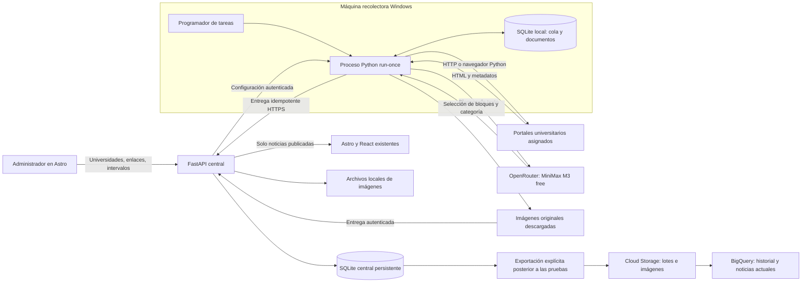

# UniNews: especificación del scraper Python con MiniMax M3

Fecha: 2026-09-06. Estado: diseño propuesto para implementar; no describe funciones ya construidas.

**Enmienda vigente (2026-10-25):** el usuario autorizó cambiar el modelo de extracción a `nvidia/nemotron-3.5-super-vl:free` tras comprobar que `minimax/minimax-m3:free` responde 404. U02 y las menciones históricas de MiniMax en este documento se leen con esa sustitución para el flujo de extracción. El modelo RAG es independiente. Véase el [plan de recuperación local](../plans/2026-10-25-recuperar-extraccion-local.md).

## Objetivo y acuerdos del usuario

Construir un recolector propio de noticias universitarias en Python, ejecutado automáticamente en una máquina Windows distinta del servidor de la plataforma. El usuario asigna las universidades y sus enlaces de noticias. Python descarga las páginas y MiniMax M3 gratuito, mediante OpenRouter, ayuda a extraer información estructurada. Los resultados se almacenan en una base de datos y se publican en Astro.

**Orden aclarado por el usuario:** desarrollar y probar primero de forma local; después subir los datos a Google Cloud para trabajarlos en BigQuery. Durante las pruebas, Astro, FastAPI, base operacional, imágenes, cola y exportaciones de prueba funcionan localmente. No se necesita crear recursos cloud para completar esa etapa. MiniMax continúa siendo el servicio remoto de OpenRouter; “local” no significa ejecutar otro LLM en el equipo.

La plataforma en Google Cloud es una fase posterior prevista, separada de la primera carga de datos a BigQuery. Primero se valida el producto local, luego se valida la exportación de datos y finalmente se despliega la plataforma cuando el usuario pase a esa etapa.

La restricción de la tesis elimina ScrapeGraphAI y sus créditos. No exige ejecutar el LLM localmente: OpenRouter y MiniMax M3 forman parte explícita de la solución acordada. No se necesita GPU para ejecutar el recolector.

Referencia histórica: [implementation_plan_webscrapper_llm.md](../../../implementation_plan_webscrapper_llm.md). Este diseño sustituye su estrategia de extracción y programación; no modifica ese documento ni toma sus marcas de progreso como evidencia de implementación.

## Global Constraints

- U01: El scraper se implementará en Python y no utilizará ScrapeGraphAI ni servicios de scraping por créditos.
- U02: El único modelo del flujo de extracción será `minimax/minimax-m3:free` mediante OpenRouter; no habrá sustitución automática por modelos de pago ni ejecución de un LLM local.
- U03: El recolector se ejecutará en Windows, en una máquina diferente del servidor de la web, API y base de datos central.
- U04: Las universidades y sus enlaces serán configurados por el administrador; el recolector no incorporará universidades descubiertas por su cuenta.
- U05: Cada noticia publicable tendrá título, cuerpo original, categoría, fecha de publicación, nombre de universidad y URL de origen.
- U06: La fecha de extracción nunca se presentará como fecha de publicación; una fecha ausente o inválida impedirá la publicación automática.
- U07: Los artículos descargados y sus pendientes sobrevivirán a reinicios, falta de cuota de OpenRouter y desconexiones de la API central.
- U08: La comunicación entre recolector y servidor se realizará mediante una API autenticada por HTTPS; no se compartirá un archivo SQLite entre máquinas.
- U09: Astro consultará las noticias publicadas mediante FastAPI; ninguna clave de OpenRouter o del recolector se incluirá en el frontend.
- U10: Una entrega repetida del mismo artículo no creará noticias duplicadas ni sobrescribirá una edición humana con una revisión antigua.
- U11: El plan y su implementación conservarán los datos existentes; las migraciones y la restauración se verificarán sobre copias.
- U12: Las pruebas automatizadas habituales no realizarán llamadas a OpenRouter ni a universidades reales.
- U13: Se extraerá la imagen principal cuando exista, conservando su origen y metadatos; una imagen ausente o fallida no se reemplazará por una imagen generada.
- U14: El desarrollo y las pruebas de aplicación se completarán primero localmente, sin exigir recursos Google Cloud; la carga real de datos a BigQuery será una etapa posterior.
- U15: BigQuery almacenará datos analíticos versionados y consultables, con carga repetible y seguimiento de publicaciones, cambios y archivos; no sustituirá la base operacional de la web.
- U16: Los agentes tendrán roles, propiedad de archivos, contratos de entrega y reglas de coordinación explícitos en AGENTS.md y en la especificación de agentes.

## Decisiones de arquitectura

### Dos máquinas, tres procesos

1. **Recolector:** Python 3.12 de 64 bits, entorno virtual propio, HTTPX, BeautifulSoup, feedparser, Pydantic 2, dateparser, tzdata, portalocker y Playwright Python opcional. No importa FastAPI, ChromaDB ni módulos de `backend`.
2. **Servidor:** FastAPI y SQLAlchemy existentes, con migraciones Alembic y un archivo SQLite central en disco persistente. Un proceso Uvicorn, transacciones cortas, WAL y tiempo de espera de escritura. El volumen inicial de una tesis no justifica imponer PostgreSQL. Una migración futura podrá hacerse sin cambiar la API del recolector.
3. **Web:** conservar Astro 6 y las islas React existentes. La web actual carga noticias mediante `fetch`; se mantendrá ese mecanismo, con recarga periódica mientras la pestaña esté visible. No se requiere un build por noticia ni prometer SSR que el proyecto hoy no tiene configurado. [Referencia de Astro](https://docs.astro.build/en/guides/framework-components/).

El servidor puede alojar frontend y API bajo el mismo dominio, encaminando `/api` a FastAPI. El recolector solo necesita conexiones salientes. La receta del servidor usará contenedores y volumen persistente; el sistema operativo del servidor no fue especificado y no condiciona el protocolo.

En desarrollo es válido ejecutar esos roles en un mismo PC mediante procesos/rutas separados y puertos localhost; también se prueba la comunicación entre la máquina Windows y otro equipo de la red antes del despliegue. HTTP solo se permite en loopback en modo desarrollo. HTTPS y tokens son obligatorios cuando se usa un dominio o comunicación entre equipos.

### Alcance de la primera versión

Incluye gestión de universidades/fuentes, extracción HTTP, RSS y HTML, paginación, perfiles configurables, soporte optativo de páginas con JavaScript, extracción asistida por LLM, imagen principal, cola durable, entrega, publicación, revisión manual, administración, programación Windows, copias de seguridad, evaluación para tesis y exportación posterior a BigQuery.

No incluye una reescritura visual, un navegador que el LLM controle, evasión de bloqueos, extracción de páginas con login, OCR/PDF, múltiples recolectores simultáneos, scraping distribuido, SSE del chat, entrenamiento de modelos o migración obligatoria a PostgreSQL. El chat RAG existente se conserva como módulo opcional; su disponibilidad no bloquea la publicación de noticias.

La migración a PostgreSQL se introduce únicamente al desplegar la plataforma en Cloud Run/Cloud SQL en la fase posterior, no como requisito para el desarrollo local ni para enviar datos a BigQuery desde el equipo local. Las reglas de agentes están en [AGENTS.md](../../../AGENTS.md) y [roles de agentes](2026-09-06-agent-roles.md).

### Extracción fiel mediante selección de bloques

Python descarga y guarda el documento antes de consultar el LLM. Construye bloques identificados de título, fecha y cuerpo, eliminando navegación, scripts y elementos repetidos. MiniMax recibe los bloques como datos y devuelve identificadores de los bloques que corresponden a título, cuerpo y fecha, además de categoría. Python reconstruye los campos copiando el texto de los bloques originales.

El LLM no redacta de nuevo el cuerpo, no determina la universidad y no inventa una fecha. Su papel de extracción es medible: selección de evidencia del documento y clasificación semántica. La salida se valida con Pydantic y reglas de negocio; pedir JSON no equivale a garantizar el esquema. MiniMax M3 free figura con precio cero y salida JSON en OpenRouter, pero la ficha no garantiza cumplimiento estricto de JSON Schema. [Ficha del modelo](https://openrouter.ai/minimax/minimax-m3%3Afree).

El resumen será opcional y separado del cuerpo, con un máximo de 500 caracteres; no será requisito de publicación ni ocasionará una segunda llamada rutinaria. Una respuesta inválida deja el documento pendiente, no lo elimina.

### Registro de fuentes

Una universidad tiene `id` y nombre único normalizado. Puede tener varias fuentes. Cada fuente guarda:

| Campo | Regla / valor inicial |
|---|---|
| `id`, `university_id`, `revision` | Identidad estable; revisión incrementada al editar configuración |
| `start_url` | URL pública de la sección de noticias asignada por el usuario |
| `allowed_hosts` | Lista explícita de hosts; inicialmente el host de `start_url` |
| `allowed_image_hosts` | Lista explícita adicional para CDN de imágenes; inicialmente vacía |
| `feed_url` | Opcional; también se puede descubrir RSS/Atom dentro del host permitido |
| `article_url_pattern` | Expresión regular validada y acotada, opcional; filtra URLs de artículos |
| `link_selector` | Inicial `article a[href]`; configurable |
| `next_selector` | Inicial `a[rel=next]`; configurable |
| `content_selector` | Opcional; selector validado durante la prueba de fuente |
| `title_selector`, `date_selector` | Iniciales `h1` y `time` |
| `render_mode`, `wait_selector` | `http` por defecto; `browser` requiere selector de espera |
| `interval_minutes` | 360 por defecto; rango permitido 15–10080 |
| `timezone` | `America/Santiago` por defecto, nombre IANA validado |
| `max_pages`, `max_articles` | 10 páginas y 100 descubrimientos nuevos por ejecución; límites configurables |
| `enabled`, `auto_publish` | Ambos falsos al crear; activar después de revisar una prueba satisfactoria |
| `validated_revision` | Revisión cuya muestra fue revisada y aceptada; editar selectores invalida la aceptación |

UPLA es la fuente de referencia del repositorio (`https://upla.cl/noticias/`), no un perfil declarado probado. Se creará inactiva. UV, PUCV u otras se incorporarán solamente cuando el administrador asigne sus enlaces. No se presume que todos los portales compartan estructura.

Una fuente nueva se prueba sin publicar y presenta hasta tres noticias de muestra, campos extraídos y errores. Al aprobar esa revisión de configuración, el administrador puede activar la recolección y la publicación automática. Es una función del producto para administrar fuentes, no un paso adicional de autorización para redactar o implementar este plan.

## Datos y estados

### Base de datos central

| Tabla | Responsabilidad y restricciones |
|---|---|
| `universities` | Nombre institucional estable; relación 1:N con fuentes |
| `sources` | Configuración versionada y control de ejecución |
| `source_versions` | Snapshot inmutable de cada revisión de configuración para auditar entregas tardías |
| `news` | Campos existentes, más `university_id`, `source_id`, `canonical_url`, `content_hash`, `published_on`, `date_precision`, `publication_status`, `editorial_lock`, `last_fetched_at` |
| `news_revisions` | Payload original recibido, hash de documento, fecha de captura, errores y estado de revisión; conserva revisiones que no se publican |
| `ingest_receipts` | Clave de entrega única, hash del payload y respuesta confirmada en la misma transacción que la revisión |
| `scrape_runs` | Solicitudes manuales, ejecuciones programadas, estado, contador por etapa y arrendamiento de solicitud |
| `collector_status` | Último contacto, última sincronización válida, tamaño/edad de cola, estado de LLM y disco disponible |
| `media_assets`, `news_media_history` | Archivo por hash y asociación versionada de imagen, fuente, alt/crédito y noticia |
| `analytics_outbox`, `export_batches` | Eventos confirmados junto con cada mutación de noticia y estado de lotes exportados |

`publication_status`: `draft`, `published`, `archived`. Una fila de `news` pública es la última revisión aprobada. Las revisiones inválidas se guardan en `news_revisions` con `review_status=pending`; no reemplazan una noticia ya publicada. La revisión humana permite corregir campos, publicar, archivar y bloquear futuras sobrescrituras automáticas.

Unicidad de noticia nueva: `(university_id, canonical_url)` cuando `canonical_url` no sea nula. El hash del cuerpo permite señalar posibles duplicados con distinta URL dentro de la misma universidad; no fusiona automáticamente artículos de universidades distintas. Identidad de revisión: `(source_id, canonical_url, document_hash, prompt_version, source_revision)`. Los reintentos de entrega usan siempre el mismo `delivery_id` UUID y payload inmutable.

Una entrega tardía con `fetched_at` anterior a la revisión actual se conserva sin revertir el artículo. Una noticia con `editorial_lock=true` conserva las ediciones humanas y recibe nuevas revisiones pendientes. Desactivar una fuente pausa nuevos trabajos; su historial permanece disponible.

### Fechas

`fetched_at` y timestamps operativos se guardan en UTC. `published_at` conserva la columna existente para ordenar; si la fuente solo informa día, se interpreta su medianoche en la zona de la fuente, se convierte a UTC y se marca `date_precision=day`. `published_on` guarda además ese día original (`YYYY-MM-DD`) y la UI lo utiliza sin conversión de zona horaria. `date_precision=instant` se usa cuando hay hora y zona verificables. No se anuncia una hora inferida al lector.

Se conserva el texto original de fecha en la revisión. No se usa `dateModified` como `datePublished`. Fecha ausente, ambigua sin evidencia, anterior a 1900 o posterior a la fecha local actual más un día: revisión manual. Un dato antiguo válido no es un error.

### Cola en Windows

El SQLite local contiene fuentes cacheadas, artículos, documentos/bloques, respuestas del LLM, salidas pendientes, ejecuciones, contadores de presupuesto y versión de esquema. No es una réplica del archivo central.

Estados de artículo: `discovered → fetched → llm_wait → ready → synced`. Alternativas: `review`, `failed`, `blocked`. `review` también se envía al servidor; `synced` significa confirmación central recibida, no publicación. Cada etapa tiene `attempts`, `next_attempt_at` y un código de error. Los cambios de estado se confirman antes de comenzar la siguiente operación externa.

El documento se guarda antes de la llamada al LLM; la respuesta validada y el payload se guardan antes del envío. Una caída entre recibir una respuesta de OpenRouter y guardarla podría repetir una llamada: se reconoce procesamiento al menos una vez, con deduplicación de entregas. No se promete ejecución exactamente una vez de servicios externos.

La configuración cacheada tiene vigencia de 24 horas. Sin API, el recolector puede trabajar con ella durante ese período; después conserva pendientes y pausa nuevos descubrimientos. Una revocación que aún no llega al equipo se hace efectiva al sincronizar o caducar la caché. Reanudar no depende de que el servidor abra una conexión a Windows.

## Programación, límites y fallos

El Programador de tareas de Windows invoca `python -m collector run-once` cada 15 minutos. Dentro de cada invocación, cada fuente se revisa solo cuando vence su intervalo o tiene una solicitud manual. La tarea usa `IgnoreNew`, un bloqueo de archivo y un máximo interno de 12 minutos; el límite externo es 14 minutos. Se configura para ejecutar sin sesión iniciada, con una cuenta dedicada y `StartWhenAvailable`.

Se procesa por turnos entre fuentes para que una universidad con mucho contenido no consuma todo el lote. Cada invocación primero intenta enviar resultados guardados, luego descubre/descarga, procesa una cuota de LLM y vuelve a enviar. Antes de cada operación externa se comprueba el tiempo restante. No se inicia un lote largo cerca del límite.

| Situación | Comportamiento obligatorio |
|---|---|
| Portal 429/503 o timeout | Respetar `Retry-After`; en ausencia usar 60, 300, 1800, 7200 y 21600 segundos con jitter; después marcar fallo visible y permitir reintento manual |
| Portal 401/403, CAPTCHA o robots denegado | `blocked`; sin evasión ni cambio automático de identidad/proxy |
| OpenRouter 429 | `llm_wait`; circuito global con próxima fecha, sin insistir por cada artículo |
| OpenRouter 401/402/403 o modelo inexistente | Pausar LLM y mostrar causa; continuar recolección; no comprar créditos ni elegir otro modelo |
| JSON inválido, IDs inexistentes o respuesta truncada | Un nuevo intento como máximo por documento; después enviar para revisión con evidencia |
| API central no disponible | Mantener outbox y reintentar el mismo payload/UUID |
| API acepta, pero se pierde la respuesta | Reenviar; recibo transaccional devuelve el mismo resultado |
| Fuente no encuentra enlaces | `no_links`; no afirmar que la web carece de noticias; prueba visible de selectores |
| Límite de paginación alcanzado | Guardar cursor y estado `partial`; continuar en siguiente invocación |
| Menos de 1 GiB libre o cola sobre 2 GiB | Pausar descargas, conservar pendientes y continuar intentando sincronizar |

Presupuesto inicial propuesto: 30 intentos LLM/día UTC, 5/minuto y concurrencia 1. Son límites internos configurables, no una afirmación sobre la cuota contratada. Todos los intentos se reservan persistentemente antes de enviarse. El chat puede compartir el límite de cuenta del proveedor aunque use otra clave, por lo que se desactiva en el despliegue inicial de recolección y solo se habilita con presupuesto reservado. Las cuotas gratuitas dependen del proveedor y se verifican en operación. [Límites de OpenRouter](https://openrouter.ai/docs/api/reference/limits).

El modelo exacto se valida al iniciar; la solicitud fija precio máximo cero para entrada y salida y no activa herramientas o plugins de pago. Si no existe un endpoint que cumpla el precio, queda pendiente. [Selección de proveedores](https://openrouter.ai/docs/guides/routing/provider-selection).

## Calidad y publicación

Publicación automática requiere: fuente habilitada con revisión validada, `auto_publish=true`, título entre 5 y 255 caracteres, cuerpo original de al menos 200 caracteres, categoría del catálogo, fecha válida, URL del host permitido, evidencia de bloques válida y ausencia de bloqueo editorial. El mínimo de cuerpo puede configurarse por fuente después de revisar sus noticias breves.

Catálogo inicial compartido: Academia, Admisión, Becas, Cultura, Deportes, Empleo, Género, Infraestructura, Investigación, Tecnología, Vinculación, Institucional, Opinión y General. Las categorías históricas se conservan y se ofrecen en los filtros si existen; no se recategorizan silenciosamente. La categoría original del portal se guarda como metadato de evidencia.

En un perfil con contenedor editorial validado, el cuerpo conserva todos sus bloques editoriales en orden; la selección del LLM no puede omitir párrafos interiores sin producir una revisión pendiente. En extracción genérica sin contenedor validado, la primera muestra siempre requiere revisión. Documentos que superen 40 000 caracteres de entrada candidata quedan en revisión con el texto íntegro; no se recorta el artículo silenciosamente ni se encadenan llamadas ilimitadas.

El frontend presenta texto escapado y párrafos; no inserta HTML remoto. Las rutas públicas de listado, detalle, estadísticas y chat no revelan borradores ni revisiones pendientes. La web recarga cada 60 segundos cuando está visible, conserva filtros/paginación y ofrece actualización manual; no altera el artículo que un lector tenga abierto.

## Imagen principal y almacenamiento local

Descubrir candidatos en la figura principal del contenedor editorial, `og:image` y `NewsArticle.image`; resolver URLs relativas y `srcset`. Escoger una imagen principal, sin intentar descargar toda la galería. Verificar que no sea logo, icono o pixel y conservar su URL original, alt/crédito cuando la fuente los publique, MIME, dimensiones y SHA-256. El LLM no inventa el crédito ni genera una ilustración.

Se aceptan JPEG, PNG y WebP, máximo 5 MiB y 40 megapíxeles; mínimo inicial 300×160 píxeles configurable por perfil. Comprobar firma/decodificación, no solo extensión o cabecera. Rechazar SVG/HTML y descargas fuera de los hosts permitidos. Un portal sin imagen válida tiene `image_status=not_found`; un error temporal tiene `pending`; un fallo agotado tiene `failed`. Estos estados son visibles en administración y el lector ve una tarjeta sin foto cuando corresponde.

Guardar primero el archivo en Windows y luego en el servidor local mediante un endpoint autenticado. Usar rutas por hash bajo `MEDIA_ROOT`; el API entrega una URL estable `/api/media/{sha256}` para imágenes asociadas a noticias publicadas. No depender de enlaces externos que puedan romperse ni incrustar datos binarios en BigQuery. Una imagen que llega después actualiza metadatos de la misma noticia con un recibo idempotente y un evento analítico, sin repetir la llamada al LLM.

Al pasar a Google Cloud, el adaptador de archivos se cambia por Cloud Storage. El archivo original queda en GCS y BigQuery recibe su URI y metadatos. La falta de imagen nunca autoriza fabricarla; el texto válido puede publicarse mientras se recupera una imagen pendiente.

## Datos en Google Cloud después de las pruebas

### Etapas y almacenamiento

| Etapa | Aplicación | Imágenes | Datos analíticos |
|---|---|---|---|
| 1. Desarrollo/pruebas locales | Astro + FastAPI + SQLite local | Disco local con rutas por hash | NDJSON local y clientes cloud simulados |
| 2. Primera carga BigQuery | Puede seguir funcionando localmente | Subida explícita a GCS si se desean conservar en cloud | Cloud Storage staging → BigQuery |
| 3. Plataforma productiva en cloud | Cloud Run + Cloud SQL PostgreSQL | GCS privado servido por la API | Mismo exportador y tablas; job separado si se automatiza |

En Cloud Run el disco de la instancia no conserva datos al terminar; por eso la fase 3 usa Cloud SQL y GCS. No montar un SQLite remoto sobre un bucket como sustituto de una DB transaccional. [Contrato de Cloud Run](https://docs.cloud.google.com/run/docs/container-contract).

### Contrato analítico

Cada alta/publicación, edición, cambio de imagen, archivo o eliminación lógica genera un evento inmutable en `analytics_outbox` dentro de la misma transacción operacional. Campos: `event_id`, `news_id`, `record_version`, `event_at`, `operation`, `publication_status`, `is_deleted`, universidad, título, cuerpo, categoría, fecha editorial, URL, hashes y metadatos/URI de imagen. Una eliminación lógica conserva un tombstone y el historial.

El exportador crea lotes NDJSON y manifiesto local (`batch_id`, IDs, número de registros y SHA-256). `prepare` no conecta a Google Cloud. `upload` usa ese lote ya revisable, carga a GCS y ejecuta un load job de BigQuery con ID persistido; después actualiza la tabla de estado actual y confirma la outbox. Repetir un lote o recuperarse tras una respuesta perdida no duplica el estado lógico ni revierte versiones nuevas.

Dataset propuesto `uninews`; tablas `news_events` (historial particionado por fecha de evento y agrupado por universidad/categoría) y `news_current` (estado más reciente por `news_id`); vista `published_news`. Clave de precedencia: `record_version`, no orden de llegada ni fecha de noticia. La exportación de una noticia archivada debe quitarla de la vista pública analítica conservando su historial.

Región inicial parametrizable `us-central1`; GCS staging y BigQuery se crean en ubicaciones compatibles, preferentemente la misma región. Proyecto/dataset/bucket son entradas de despliegue. Las cargas JSON utilizan JSON delimitado por línea y un esquema explícito. [Carga JSON desde GCS](https://docs.cloud.google.com/bigquery/docs/loading-data-cloud-storage-json), [ubicaciones BigQuery](https://docs.cloud.google.com/bigquery/docs/locations).

En pruebas se usan archivos locales y clientes fake. En la primera carga real se usa autenticación local de Google Cloud mediante credenciales de aplicación, sin versionar una clave JSON. En ejecución cloud posterior se usa una cuenta de servicio asociada al job con permisos sobre su dataset y buckets; la API pública no recibe permisos para administrar BigQuery.

La gratuidad acordada corresponde al scraper propio y MiniMax free. No se presupone que Cloud SQL, almacenamiento, consultas o despliegue cloud sean gratuitos; la fase de subida debe incluir configuración de presupuesto y límites de consulta. No se crean ni activan recursos cloud al escribir este plan.

## Prueba de tesis y definición de terminado

### Evaluación reproducible

Preparar un corpus consentido de fuentes asignadas: objetivo de 60 artículos de al menos tres universidades, 20 por universidad. Si inicialmente solo se asigna una, ejecutar el piloto técnico allí y declarar que aún no demuestra generalización multiuniversidad. Separar 30 artículos para ajustar perfiles/prompts y 30 para evaluación final; conservar HTML, fecha de captura y anotaciones manuales.

Comparar sobre los mismos documentos: A) Python con reglas/metadata, B) Python con MiniMax seleccionando evidencia y categoría. Registrar exactitud de título, fecha y universidad; precisión/recobrado de tokens del cuerpo; macro-F1 de categoría; tasa de publicación correcta; tiempo por artículo; número de llamadas y pendientes por cuota. Un resultado inferior del LLM también es un resultado válido; no se presupone mejora.

Metas de aceptación propuestas, a medir: título/universidad correctos ≥95%, fecha correcta ≥95% entre artículos con fecha verificable, F1 del cuerpo ≥0,95, macro-F1 de categoría ≥0,80 y cero hechos inventados en título/cuerpo/fecha publicados automáticamente dentro del corpus. Reportar numeradores, denominadores, errores y dispersión; no presentar estas metas como resultados obtenidos.

### Criterios verificables

- AC01: Registrar y probar una fuente requiere introducir universidad y URL, sin editar Python para un portal compatible con los perfiles existentes.
- AC02: El recolector funciona 72 horas en Windows sin una sesión interactiva abierta; conserva pendientes ante reinicio y cortes de red simulados.
- AC03: Repetir una ejecución sin cambios no crea noticias ni nuevas llamadas LLM para documentos ya procesados.
- AC04: Un 429 de OpenRouter no impide guardar documentos y se recupera cuando corresponde reintentar.
- AC05: Reenviar 100 veces el mismo payload produce una sola noticia y una sola revisión.
- AC06: Cada noticia pública muestra los campos U05; un dato ausente aparece en revisión, nunca fabricado.
- AC07: Una noticia publicada se ve al cargar la página o en el siguiente refresco visible de 60 segundos.
- AC08: Un usuario público no puede modificar fuentes/noticias ni acceder a borradores, incluso por ID o chat.
- AC09: La migración y una restauración conservan artículos existentes, IDs y ediciones humanas.
- AC10: El corpus y sus métricas permiten defender la contribución y sus límites con evidencia.
- AC11: Una noticia con imagen válida presenta esa imagen original y su trazabilidad; ausencia, fallo y llegada tardía se prueban sin fotos inventadas.
- AC12: La aplicación completa, sus pruebas y la preparación de lotes funcionan localmente sin proyecto o credenciales Google Cloud.
- AC13: Un lote cargado dos veces deja una sola versión lógica por noticia en BigQuery; una edición/archivo/eliminación lógica posterior se refleja correctamente.
- AC14: Los roles y propiedad de archivos están definidos; la fase productiva, si se ejecuta, conserva datos al reemplazar instancias y mantiene el recolector Windows separado.

## Fuentes técnicas adicionales

- [HTTPX: límites de tiempo](https://www.python-httpx.org/advanced/timeouts/).
- [Playwright Python: control de red](https://playwright.dev/python/docs/network).
- [Python: robots.txt](https://docs.python.org/3/library/urllib.robotparser.html).
- [SQLite: respaldo mediante API](https://docs.python.org/3/library/sqlite3.html).
- [Alembic: migraciones por lotes en SQLite](https://alembic.sqlalchemy.org/en/latest/batch.html).
- [Windows: configuración de tareas programadas](https://learn.microsoft.com/en-us/powershell/module/scheduledtasks/new-scheduledtasksettingsset?view=windowsserver2025-ps).

Consultadas el 2026-09-06. La selección de arquitectura y sus límites son decisiones de este proyecto; los documentos enlazados sustentan las capacidades técnicas, no garantizan la disponibilidad futura de una cuota gratuita.
