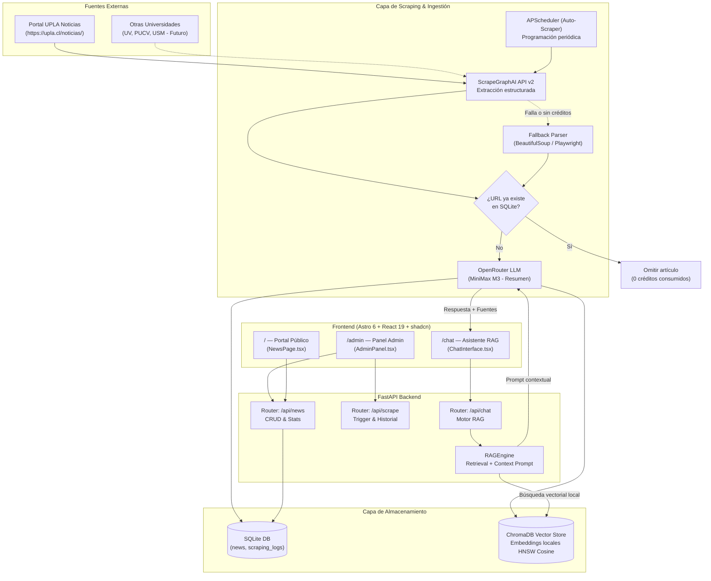

# Sistema de Noticias Universitarias con LLM + RAG (UniNews UPLA)

## Descripción General

**UniNews UPLA** es una plataforma integral para la captura automatizada, gestión, almacenamiento y consulta inteligente de noticias universitarias (enfocada inicialmente en la [Universidad de Playa Ancha](https://upla.cl/noticias/)). Incorpora un asistente conversacional basado en **RAG (Retrieval-Augmented Generation)** que responde preguntas en lenguaje natural basándose exclusivamente en las fuentes indexadas.

El proyecto cuenta con una primera versión funcional completa (Full-Stack) y se encuentra en la rama `python-autoscrapper` para incorporar automatización periódica del scraping, monitoreo de ejecuciones, scrapers de contingencia y soporte multi-fuente.

---

## Estado Actual del Proyecto (Implementado vs Pendiente)

### Matriz de Progreso

| Módulo / Característica | Estado | Detalles de Implementación |
|---|:---:|---|
| **Frontend Público (Noticias)** | ✅ Completado | Astro 6 + React 19 + Tailwind CSS 4. Filtros, búsqueda, cards interactivas, modal de lectura, botón IA para resumen y redirección a fuente original. |
| **Frontend Chat IA (RAG)** | ✅ Completado | Interfaz conversacional con citas de fuentes, insignias de relevancia/distancia, badges de estado del motor RAG y sugerencias de preguntas. |
| **Panel de Administración** | ✅ Completado | CRUD completo de noticias, estadísticas en tiempo real, formulario de creación/edición y modal de importación manual desde UPLA. |
| **Backend REST API** | ✅ Completado | FastAPI con CORS, validación Pydantic (`schemas.py`), endpoints modulares (`news`, `chat`, `scraper`). |
| **Base de Datos Relacional** | ✅ Completado | SQLite (`university_news.db`) con SQLAlchemy (`models.py`, `database.py`). Auto-migración liviana en inicio (`ensure_schema`). |
| **Web Scraping Estructurado** | ✅ Completado | ScrapeGraphAI v2 (`backend/scraping/upla.py`). Extracción de listado y artículo individual con schema tipado. |
| **Deduplicación de Noticias** | ✅ Completado | Verificación previa por `source_url` para evitar consumo redundante de créditos de API. |
| **Resúmenes Automáticos con LLM** | ✅ Completado | OpenRouter con modelo `minimax/minimax-m3:free` generando resúmenes concisos en español al importar noticias. |
| **Vector Store & Embeddings** | ✅ Completado | ChromaDB persistente (`./chroma_db`, colección `university_news_local_v2`) con embeddings locales de `sentence-transformers` (sin consumo de API). |
| **RAG Grounding & Citas** | ✅ Completado | Búsqueda semántica con cálculo de distancia coseno, filtrado por umbral (`RAG_MAX_DISTANCE`) y prompt estricto con fuentes. |
| **Scraping Automático Programado** | 🔄 En progreso | Rama `python-autoscrapper`: Scheduler en segundo plano (APScheduler) para ejecución periódica sin intervención manual. |
| **Historial y Logs de Scraping** | ⏳ Planificado | Tabla `scraping_logs` en base de datos para auditar ejecuciones, artículos encontrados, creados, omitidos y fallos. |
| **Fallback Scraper Local** | ⏳ Planificado | Parser de respaldo con `BeautifulSoup`/`Playwright` para contingencias ante límites de cuota de ScrapeGraphAI. |
| **Streaming de Respuestas en Chat** | ⏳ Planificado | Endpoint SSE en `/api/chat` para generación en tiempo real palabra por palabra. |
| **Despliegue Contenedorizado** | ⏳ Planificado | `Dockerfile` y `docker-compose.yml` para despliegue productivo con persistencia de SQLite y ChromaDB. |

---

## Arquitectura del Sistema



---

## Stack Tecnológico Actual

| Capa | Tecnología | Versión / Detalle | Propósito |
|---|---|---|---|
| **Frontend Framework** | Astro | `^6.0.0` | Server-driven scaffolding, SSR híbrido y optimización de assets |
| **Frontend UI Library** | React | `^19.2.6` | Componentes interactivos (`NewsPage`, `ChatInterface`, `AdminPanel`) |
| **Estilos & UI Kit** | Tailwind CSS + shadcn/ui | Tailwind v4, Base UI, Lucide React | Sistema de diseño moderno, dark/light mode (`next-themes`), animaciones |
| **Tipografía** | Fontsource | Geist, DM Sans, Instrument Serif | Fuentes variables de alta legibilidad y jerarquía visual |
| **Backend Framework** | FastAPI | Python `>=3.10` | API REST asíncrona de alto rendimiento con documentación OpenAPI |
| **Base de Datos** | SQLite + SQLAlchemy | SQLAlchemy `^2.0` | Almacenamiento relacional de artículos, metadatos y logs |
| **Web Scraping Principal**| ScrapeGraphAI | API v2 (`v2-api.scrapegraphai.com`) | Extracción guiada por esquemas JSON sin requerir selectores CSS frágiles |
| **Proveedor LLM** | OpenRouter | `minimax/minimax-m3:free` | Generación de resúmenes estructurados y respuestas en lenguaje natural |
| **Motor Vectorial (RAG)**| ChromaDB | `chromadb` local persistente | Almacenamiento HNSW con distancia coseno en `./chroma_db` |
| **Embeddings** | Local Sentence-Transformers | `DefaultEmbeddingFunction` de Chroma | Vectorización local sin llamadas a API externa ni consumo de cuota |
| **Orquestación Dev** | Concurrently | `npm run dev:all` | Ejecución concurrente de frontend (`:4321`) y backend (`:8000`) |

---

## Variables de Entorno

### `backend/.env`
| Variable | Requerida | Valor por Defecto / Descripción |
|---|:---:|---|
| `OPENROUTER_API_KEY` | Sí | Clave de API de OpenRouter para resúmenes y chat |
| `OPENROUTER_MODEL` | Sí | `minimax/minimax-m3:free` (modelo principal para RAG) |
| `SGAI_API_KEY` | Sí* | Clave oficial de ScrapeGraphAI v2 |
| `API_SCRAPEGRAPHAI` | Sí* | Alias compatible con la configuración previa |
| `OPENROUTER_SITE_URL` | No | `http://localhost:4321` (identificador enviado a OpenRouter) |
| `OPENROUTER_APP_NAME` | No | `UniNews UPLA` |
| `SGAI_TIMEOUT` | No | `120` (tiempo máximo de espera de scraping en segundos) |
| `RAG_MAX_DISTANCE` | No | `0.95` (umbral máximo de distancia coseno para considerar un doc relevante) |
| `SCRAPER_AUTO_ENABLED`| No | `true` *(próxima implementación)*: Habilitar scraper periódico |
| `SCRAPER_INTERVAL_HOURS`| No| `6` *(próxima implementación)*: Intervalo en horas para auto-scrape |

*\* Debe definirse `SGAI_API_KEY` o `API_SCRAPEGRAPHAI`.*

### `/.env` (Frontend)
| Variable | Requerida | Descripción |
|---|:---:|---|
| `PUBLIC_API_URL` | Sí | URL base del backend FastAPI (ej. `http://localhost:8000`) |

---

## Roadmap de Implementación (Rama: `python-autoscrapper` y Futuro)

### Fase 1: Consolidación y Estabilización (✅ Completado)
- [x] CRUD de noticias con categorización, autor, fecha y distinción de destacadas.
- [x] Conexión con ScrapeGraphAI v2 para importar artículos recientes de UPLA.
- [x] Resumen automático con MiniMax M3 vía OpenRouter.
- [x] Colección local de ChromaDB (`university_news_local_v2`) y retrieval con distancia coseno.
- [x] Páginas públicas, panel de administración y chat conversacional con enlaces a fuentes originales.

---

### Fase 2: Automatización y Resiliencia del Scraping (`python-autoscrapper`) (🚀 En Desarrollo)

> [!IMPORTANT]
> El objetivo central de esta fase es que el sistema no dependa de que un administrador presione "Importar UPLA" manualmente, sino que opere de forma autónoma con auditoría transparente.

#### Tarea 2.1: Scheduler en Segundo Plano (Backend)
- **Objetivo**: Ejecutar periódicamente la revisión de nuevas noticias sin bloquear el servidor.
- **Implementación**:
  - Incorporar `APScheduler` (`AsyncIOScheduler`) dentro del ciclo de vida (`lifespan`) en `backend/main.py`.
  - Configurar intervalo mediante `SCRAPER_INTERVAL_HOURS` (por defecto cada 6 horas).
  - Ejecutar la función de sincronización evitando solapamientos (`max_instances=1`).

#### Tarea 2.2: Tabla y Modelo de Auditoría (`ScrapingLog`)
- **Archivo**: `backend/models.py`, `backend/schemas.py`, `backend/database.py`
- **Campos**:
  - `id`: Entero auto-incremental
  - `portal_name`: Cadena (ej. "UPLA")
  - `triggered_by`: "scheduled" | "manual"
  - `started_at`: Timestamp
  - `finished_at`: Timestamp
  - `status`: "running" | "success" | "partial" | "failed"
  - `found_count`: Total de URLs descubiertas en el listado
  - `created_count`: Nuevas noticias agregadas a SQLite e indexadas
  - `skipped_count`: Noticias omitidas por ya existir
  - `failed_count`: Artículos que fallaron al procesarse
  - `error_log`: Texto con detalles o trazas de error

#### Tarea 2.3: Endpoints de Gestión y Monitoreo del Scraper
- **Archivo**: `backend/routers/scraper.py`
  - `GET /api/scrape/status`: Estado del scraper (última ejecución, próxima ejecución programada, estado del scheduler).
  - `GET /api/scrape/logs`: Listado paginado de las últimas ejecuciones registradas.
  - `POST /api/scrape/toggle`: Habilitar o pausar el auto-scraper en tiempo de ejecución.
  - `POST /api/scrape/upla`: Refactorizar para registrar la ejecución en `ScrapingLog`.

#### Tarea 2.4: Integración en el Panel de Administración (UI)
- **Archivo**: `src/components/AdminPanel.tsx`
  - Nueva pestaña o tarjeta de **"Automatización de Scraping"**.
  - Indicador del estado del servicio (Activo / En pausa / Ejecutando).
  - Tabla de historial de ejecuciones recientes con badges de estado (Éxito, Fallos, Noticias nuevas).
  - Interruptor para activar/desactivar el scraping automático.

#### Tarea 2.5: Scraper de Contingencia (Fallback Local)
- **Objetivo**: Si ScrapeGraphAI agota créditos, sufre timeout o retorna error 429/502, el sistema debe degradarse elegantemente sin interrumpir la ingesta.
- **Implementación**:
  - Crear `backend/scraping/fallback_upla.py` utilizando `httpx` + `BeautifulSoup4`.
  - Extraer los elementos estándar del DOM de WordPress de `upla.cl/noticias` (`article`, `entry-title`, `entry-content`, `post-date`).
  - Activar el fallback automáticamente cuando `ScrapeGraphError` sea capturado en `UplaScraper`.

---

### Fase 3: Expansión Multi-Portal y Multi-Universidad (⏳ Siguiente)

#### Tarea 3.1: Abstracción de Scrapers (`BaseScraper`)
- Crear una clase abstracta `BaseUniversityScraper`:
  - `get_latest_articles(limit: int) -> list[ArticlePreview]`
  - `get_article_detail(url: str) -> ArticleDetail`
- Permitir registrar múltiples portales universitarios de la Región de Valparaíso:
  - Universidad de Valparaíso (UV)
  - Pontificia Universidad Católica de Valparaíso (PUCV)
  - Universidad Técnica Federico Santa María (USM)

#### Tarea 3.2: Filtrado Multi-Universidad en RAG
- Adaptar `RAGEngine.query()` para soportar filtrado por metadato: `{"university": selected_university}`.
- Permitir que el usuario en `/chat` filtre si desea consultar sobre una universidad en particular o sobre todas las universidades.

---

### Fase 4: Optimización del Asistente RAG & UX (⏳ Siguiente)

#### Tarea 4.1: Streaming de Respuestas (SSE)
- Actualizar `backend/routers/chat.py` para usar `StreamingResponse` de FastAPI con generador asíncrono.
- Actualizar `ChatInterface.tsx` para consumir el stream con `fetch` y `ReadableStreamDefaultReader`.

#### Tarea 4.2: Chunking Inteligente de Noticias Extensas
- Si una noticia supera los 1500 caracteres, dividir en chunks solapados (overlap de 200 caracteres) antes de indexar en ChromaDB para evitar pérdida de contexto en artículos largos.

#### Tarea 4.3: Historial Multi-Turno en Chat
- Incluir los últimos 2-3 turnos de conversación en el prompt de OpenRouter para permitir preguntas de seguimiento contextuales (ej. "¿Cuándo vence esa postulación?").

---

### Fase 5: Preparación para Producción y DevOps (⏳ Siguiente)

#### Tarea 5.1: Dockerización Completa
- `backend/Dockerfile`: Imagen Python slim con dependencias compiladas y volumen para `/app/university_news.db` y `/app/chroma_db`.
- `Dockerfile` (raíz): Build multi-stage de Astro.
- `docker-compose.yml`:
  ```yaml
  services:
    backend:
      build: ./backend
      ports: ["8000:8000"]
      volumes:
        - backend_data:/app/data
      env_file: ./backend/.env
    frontend:
      build: .
      ports: ["4321:4321"]
      environment:
        - PUBLIC_API_URL=http://backend:8000
  volumes:
    backend_data:
  ```

#### Tarea 5.2: Despliegue en la Nube
- **Frontend**: Despliegue estático o SSR en Vercel / Netlify.
- **Backend**: Despliegue en servicio con almacenamiento persistente (Railway, Render o VPS con Coolify/Docker) para conservar SQLite y ChromaDB.

---

## Plan de Verificación y Testing

### 1. Verificación del Backend
```powershell
# Activar entorno virtual
cd backend
venv\Scripts\Activate.ps1

# 1. Comprobar salud general de la API
curl http://localhost:8000/health

# 2. Comprobar estado del chat y motor RAG
curl http://localhost:8000/api/chat/status

# 3. Probar importación de scraping UPLA (manual)
Invoke-RestMethod -Method Post -Uri http://localhost:8000/api/scrape/upla -ContentType "application/json" -Body '{"limit": 3}'

# 4. Probar consulta al asistente RAG
Invoke-RestMethod -Method Post -Uri http://localhost:8000/api/chat/ -ContentType "application/json" -Body '{"question": "¿Qué noticias hay sobre la Universidad de Playa Ancha?"}'
```

### 2. Verificación del Frontend
- [ ] Ejecutar `npm run dev:all` y verificar que no haya errores de compilación en Vite/Astro ni en FastAPI.
- [ ] **Home (`/`)**: Verificar carga de noticias, filtros de categoría, selector de tema claro/oscuro y apertura del modal con botón de resumen IA y redirección a fuente.
- [ ] **Admin (`/admin`)**: Crear una noticia de prueba, verificar que se guarda en SQLite y se indexa en ChromaDB. Probar importación UPLA con diálogo de progreso.
- [ ] **Chat (`/chat`)**: Realizar preguntas sobre las noticias importadas y confirmar que la respuesta cita las fuentes correctas con enlaces válidos.
